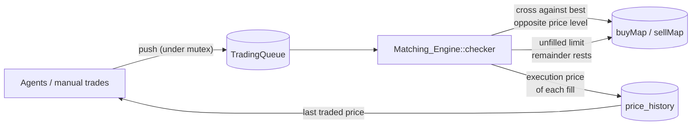

# Limit Order Book Library

A price-time priority **limit order book and matching engine** written in C++17, with a
small market simulation driven by automated trading agents, Python bindings via
pybind11, a correctness test suite, and a Google Benchmark performance harness.

The project models the core of an electronic exchange: orders arrive, the engine crosses
them against the best resting price on the opposite side, partial fills are handled
order by order, and anything left over rests in the book in arrival order. Simple
trading agents (a market maker, noise traders, a trend follower, and a "whale") generate
order flow so the book and its price can be observed evolving over time.

## Highlights

- **Price-time priority matching**: best price first, then first-in-first-out within a price level
- **Limit and market orders**, including partial fills that sweep several price levels
- **Agent-based market simulation** with five agent types that react to the last traded price
- **Python API** (`orderbook_wrapper`) for driving the book and simulation from Python
- **Deterministic correctness tests** run through CTest
- **Reproducible benchmarks** with a fixed RNG seed and setup excluded from timing

## How it works



1. An order is created (by an agent or by `manual::trade`) and pushed onto a queue.
2. The matching engine drains the queue. For each order it repeatedly matches against
   the **oldest order at the best opposite price** while the price is acceptable
   (a market order accepts any price).
3. Every fill executes at the **resting order's price** and is appended to `price_history`.
4. A limit order's unfilled remainder is appended to the back of its price level.
   A market order's unfilled remainder is discarded.
5. Agents read the last traded price to decide what to submit next.

The book is two ordered maps keyed by integer price:

| Side | Container | Best price |
|---|---|---|
| Bids | `std::map<int, PriceLevel, std::greater<int>>` | `buyMap.begin()` (highest) |
| Asks | `std::map<int, PriceLevel>` | `sellMap.begin()` (lowest) |

Each `PriceLevel` holds a `std::list<Order>` that acts as the FIFO queue for that price.

### Worked example

Starting from an empty book, with resting asks of **3 @ $100**, **4 @ $101** and
**10 @ $103**, a limit **buy 10 @ $102** arrives:

| Step | Matches against | Fill | Buyer remaining |
|---|---|---|---|
| 1 | 3 @ $100 (best ask) | 3 @ $100 | 7 |
| 2 | 4 @ $101 (new best ask) | 4 @ $101 | 3 |
| 3 | 10 @ $103 | none: $103 is above the $102 limit | 3 |

The remaining **3 shares rest as a bid at $102**, `price_history` becomes `[100, 101]`, and
the $103 ask is untouched. This exact scenario is one of the automated tests.

## Quick start

### Requirements

- CMake 3.14+
- A C++17 compiler (developed with MinGW-w64 GCC 16.1 on Windows)
- Python 3 with development headers, for the Python module (developed with Python 3.14)
- Internet access on first configure: CMake downloads pinned releases of
  [pybind11](https://github.com/pybind/pybind11) v3.0.1 and
  [Google Benchmark](https://github.com/google/benchmark) v1.9.5

### Build

```powershell
cmake -S . -B build -G Ninja -DCMAKE_BUILD_TYPE=Release
cmake --build build
```

`-G "MinGW Makefiles"` also works on Windows. The project defaults to a Release
(optimized) build when no build type is given; pass `-DCMAKE_BUILD_TYPE=Debug` for debugging.

| Output | Description |
|---|---|
| `libLimit_Order_Book.a` | Static library containing the engine and agents |
| `orderbook_wrapper.*.pyd` | Python extension module |
| `orderbook_tests.exe` | Correctness tests |
| `benchmark_test.exe` | Performance benchmarks |

### Run the tests

```powershell
ctest --test-dir build --output-on-failure
```

### Use it from Python

Run from the `build` directory, or add it to `sys.path`:

```python
import orderbook_wrapper as ob

market = ob.GlobalVariables()
me = ob.Manual(market)

me.trade(101, 5, ob.Side.Sell, ob.OrderType.Limit, market)  # ask: 5 @ $101
me.trade(102, 3, ob.Side.Sell, ob.OrderType.Limit, market)  # ask: 3 @ $102
me.trade(99,  4, ob.Side.Buy,  ob.OrderType.Limit, market)  # bid: 4 @ $99
me.trade(102, 6, ob.Side.Buy,  ob.OrderType.Limit, market)  # crosses both asks

print(market.price_history)                                          # [101, 102]
print({p: lvl.total_shares for p, lvl in market.sellMap.items()})    # {102: 2}
print({p: lvl.total_shares for p, lvl in market.buyMap.items()})     # {99: 4}
```

A simulation with several agents:

```python
import orderbook_wrapper as ob

market = ob.GlobalVariables()
maker, noise = ob.MarketMaker(market), ob.NoiseTrader(market)
whale, trend = ob.Whale(market), ob.TrendFollower(market)

maker.loop(200)
noise.loop(200)
for _ in range(100):
    whale.execute()
    trend.execute()

print(len(market.price_history), "trades, last price", market.price_history[-1])
ob.Order_Book().printer(market)   # clears the terminal and prints the book
```

See [docs/api.md](docs/api.md) for the full C++ and Python reference.

## Testing

[test.cpp](test.cpp) contains nine deterministic scenarios, each on a fresh book:
empty-book insertion, non-crossing and crossing limits, partial fills in both directions,
sweeping multiple price levels, FIFO priority at one price, and market orders whose size
exceeds the available liquidity on either side. Assertions stay enabled even in Release
builds. Details are in [docs/testing.md](docs/testing.md).

## Performance

[benchmark.cpp](benchmark.cpp) measures the matching engine on its own, using a
pre-generated order stream, as well as a mixed market of all four agents and each agent
separately. Every measured batch starts from an identical book built from a fixed seed,
with setup and teardown excluded from timing. Each result also reports how many fills
the batch produced, so a fast number can't hide a batch that never traded.

10,000 timed items after 1,000 setup submissions, median of 20 repetitions. Release
build (`-O3`), MinGW-w64 GCC 16.1.0, Windows 11, AMD Ryzen AI 9 HX 370, pinned to one
core, 2026-10-15:

| Benchmark | Time per item | Items / s | Fills in batch |
|---|---:|---:|---:|
| Matching engine (per order) | 63 ns | 15.9 M | 4,489 |
| Mixed market (per agent execution) | 93 ns | 10.8 M | 41,596 |
| Noise trader | 78 ns | 12.8 M | 1,809 |
| Whale | 73 ns | 13.7 M | 10,321 |

The market-maker and trend-follower benchmarks are also reported, but on their own
these agents produce no trades: the price never moves without other traders. Their
behaviour is measured inside the mixed market instead. Methodology, all results, and
caveats are in [docs/benchmarking.md](docs/benchmarking.md).

## Design decisions

| Decision | Reason |
|---|---|
| Ordered `std::map` per side | Best bid/ask is always `begin()`, and empty levels can be erased cheaply by iterator |
| `std::list` per price level | O(1) append at the back and pop at the front preserves time priority without timestamps |
| Integer prices | Exact comparisons with no floating-point rounding; one tick equals $1 |
| Execution at the resting price | Standard exchange convention: the order that provided liquidity sets the price |
| Inbound queue before matching | Decouples order submission from matching, so agents can submit from several threads |

| Operation | Complexity (L = price levels on a side, k = fills) |
|---|---|
| Read best bid / ask | O(1) |
| Rest a limit order | O(log L) |
| Process an incoming order | O(k + log L) |

## Limitations and roadmap

This is a learning project, and some features of a production exchange are deliberately
not implemented yet:

- **No cancel or modify.** Supporting it needs an `order_id` → list-iterator index.
- **No execution reports.** Fills are visible only through `price_history`, and an unfilled
  market-order remainder is dropped silently.
- **Single-threaded in practice.** The queue and book are guarded by `market_mutex`, but agents
  read `price_history`, the RNG, and the order counter outside the lock.
- **Python containers are copies.** `price_history`, `buyMap`, and `sellMap` convert to Python
  lists/dicts, so mutating them in place from Python does not change the C++ state.
- **Integer prices** only, with a fixed $1 tick.

Planned next steps: order cancellation, execution reports, per-order latency
percentiles, and a Python notebook that plots simulated price paths.

## Project structure

```text
.
├── variables.h            Order, PriceLevel, and the shared market state (Global_Variables)
├── matching_engine.h/.cpp Queue draining and price-time priority matching
├── order_book.h/.cpp      Console rendering of the book
├── Agents.h/.cpp          Agent base class and five agent types
├── python_bindings.cpp    pybind11 module definition (orderbook_wrapper)
├── test.cpp               Correctness tests (CTest)
├── benchmark.cpp          Google Benchmark harness
├── CMakeLists.txt         Build for the library, Python module, tests, and benchmarks
├── PROJECT_RECAP.md       Maintainer notes
└── docs/
    ├── architecture.md    Data structures, matching algorithm, concurrency model
    ├── agents.md          Behaviour of each trading agent
    ├── api.md             C++ and Python API reference
    ├── testing.md         What each test verifies
    └── benchmarking.md    Benchmark methodology, results, and caveats
```

## Motivation

I built this project to learn market microstructure (how bids, asks, spreads, and price
discovery work), how an exchange matching engine enforces fairness between orders,
C++ data-structure and concurrency trade-offs, and how to measure performance without
fooling yourself.
